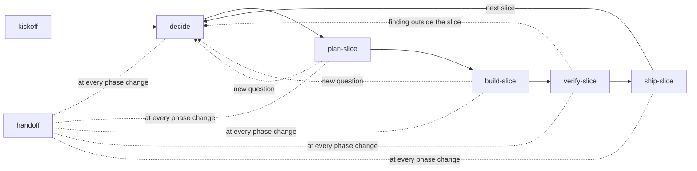

# Decide, Build, Ship

A decision-first skills pack for Claude Code. It helps anyone build a product end to end with Claude: a web or
mobile app, a backend system, an AI or agent product, or a startup MVP.

Most build workflows start at the code. This one starts at the decisions. Before anything is built, Claude
checks the spec, explains each open question in plain words, asks you, and then reviews your answers from
several perspectives and tells you when one looks wrong or risky. Then it plans thin slices, builds them test
first with parallel agents, proves them with a fast gate and a live check, ships only when green and approved,
and keeps a handoff file so work survives a context limit or a restart.

## Who it is for

- Founders and solo builders who decide what the product does and want Claude to push back before building
  the wrong thing.
- Small teams who want one repeatable flow from spec to release, with evidence a reviewer can read.
- Anyone building an AI feature who needs evals, cost and latency budgets, and prompt-injection safety in the
  plan rather than as an afterthought.

It assumes no stack, language, hosting or country. Project-specific details (commands, branches, paths,
approvals) live in your project's `CLAUDE.md`.

## The skills

| Skill | What it does | Triggers when you... |
|---|---|---|
| `kickoff` | Adds a `Build workflow` section to `CLAUDE.md` and creates the decisions log, handoff file and templates, after you confirm | start a repository or adopt the workflow |
| `decide` | Spec first; explains each question with a short story, asks, reviews every answer from users, buyer, customer, business, data, security, cost and AI perspectives; records answers; tells running agents about changes | start a product, feature or slice, or answer a question |
| `plan-slice` | Splits work into thin vertical slices; plans the next one: decisions, edge cases, tests, screens, files, evidence; writes the feature doc and ADR | ask for a plan, a breakdown or the next slice |
| `build-slice` | Docs before code, contract first, failing test first, parallel builders in worktrees with one writer per file set and a model per task | say "build it" or delegate implementation |
| `verify-slice` | Changed-only gate, parallel reviews, a live check of the real app, AI evals against a baseline, evidence | ask "is it done?" or prepare to merge |
| `ship-slice` | Merges only when green and approved, never force-pushes shared branches, runs releases and the after-merge tidy-up | say "merge", "push", "ship" or "release" |
| `handoff` | Keeps a paste-ready handoff file in the repo; resumes from it | near a limit, before a restart, at each phase change |

## How the skills chain



Each skill ends by naming the next one. Any skill that meets an open question sends it back to `decide`, so
nothing is decided silently in code.

## Install

### As a plugin (recommended)

In Claude Code:

```text
/plugin marketplace add RohitBind123/decide-build-ship
/plugin install decide-build-ship@decide-build-ship
```

Or from a shell:

```bash
claude plugin marketplace add RohitBind123/decide-build-ship
claude plugin install decide-build-ship@decide-build-ship
```

Plugin skills are namespaced: run them as `/decide-build-ship:decide`, `/decide-build-ship:plan-slice` and so
on, or just describe what you want and Claude picks the skill.

### As plain skill folders

Copy the folders into a project (shared with everyone who clones it) or into your personal skills:

```bash
git clone https://github.com/RohitBind123/decide-build-ship.git
cp -R decide-build-ship/skills/* your-project/.claude/skills/     # this project only
cp -R decide-build-ship/skills/* ~/.claude/skills/                # all your projects
```

Copied skills run as `/decide`, `/plan-slice` and so on. Copy all seven together: `kickoff` reads its
templates from the sibling skills. If you already have a personal skill with the same name, yours wins.

### Try it without installing

```bash
git clone https://github.com/RohitBind123/decide-build-ship.git
claude --plugin-dir ./decide-build-ship
```

## A five-minute walkthrough

Loafly is a fictional pre-order app for one bakery: customers order bread for next-day pickup, staff work from
an order board, and later an AI assistant answers ingredient questions. Riley owns the bakery and decides what
the app does.

**1. Set up (one minute).** In the Loafly repository, Riley says: "Set this repo up for the workflow."
`kickoff` reads `package.json`, proposes the build and test commands it found, the branches, the docs paths and
the approvals, and asks Riley to confirm. It then appends a `Build workflow` section to `CLAUDE.md` and creates
`docs/decisions.md` and `tasks/handoff.md`.

**2. Decide (two minutes).** Riley says: "Customers should pick a pickup time when they order."
`decide` finds no spec for this, drafts a one-page spec from the conversation, and gets it approved. Then it
explains the open questions:

> D2. How many orders can one pickup slot take?
> Story: Saturday at 9 am is the rush. If twenty people pick 9:00, the queue reaches the street.
> A (recommended): Riley sets a limit per slot, default 10; a full slot shows "Full".
> B: no limit. Simpler, but the rush stays.

Riley answers in the question dialog. `decide` reviews each answer. One of them, "let the assistant answer
allergen questions from its general knowledge", gets pushed back: a confident wrong answer about nuts could
harm a customer, so it recommends answering only from the bakery's ingredient sheets and handing anything else
to staff. Riley agrees. Every answer goes into `docs/decisions.md` in Riley's words
([see the filled example](docs/example-decisions-log.md)).

**3. Plan (one minute).** `plan-slice` splits the work into slices, riskiest first, and plans slice 1:
pickup slots end to end, the edge cases (two customers taking the last place at once, a limit lowered below
existing orders), the tests, the files, and the screen Riley needs to set the limits. It commits the feature
doc before any code.

**4. Build, verify, ship (one minute to start).** `build-slice` commits the API contract, then runs an API
builder and a web builder in separate worktrees, each writing a failing test first. `verify-slice` runs the
changed-only gate, the reviews and a live check of the real app with synthetic orders, and saves the evidence.
`ship-slice` shows Riley the result and asks "Approve merge". When Riley's laptop needs a restart halfway,
Riley says "save where we are" and `handoff` writes the branch, the running builders, the open questions and
the exact next step to `tasks/handoff.md`; the next session resumes from it.

## Configuration

Everything project-specific is a key in the `Build workflow` section of `CLAUDE.md`: paths, branches, merge
style, commands, the gate, the live check, models per task, reviewers, approvals and project rules. See
[docs/configuration.md](docs/configuration.md) for every key and its default.

## Testing

- `python3 scripts/check_skills.py`: structural lint, free.
- `claude plugin validate .`: the official validator, free.
- `claude plugin eval . --allow-tools Write --no-publish`: behavioural cases (trigger and behaviour checks,
  plus must-not-trigger checks); these use model calls. Without `--no-publish` the report is published to
  your claude.ai account.

Details and a manual trigger checklist: [docs/testing.md](docs/testing.md). Research behind the design:
[docs/research-notes.md](docs/research-notes.md).

## Design principles

- **The owner decides; Claude reviews.** Choices are explained before they are asked and checked before they
  are built on.
- **Product-agnostic.** No stack, country or tool is assumed; the project's `CLAUDE.md` fills the gaps.
- **Small skills, detail on demand.** Each `SKILL.md` is about 120 lines or fewer; detail lives in `references/` and
  templates in `assets/`, loaded only when needed.
- **Portable.** Frontmatter uses only `name`, `description` and `license`, so the same folders work as a
  plugin, as copied skills, and in other tools that read the Agent Skills format.

## Contributing

See [CONTRIBUTING.md](CONTRIBUTING.md). Changes are recorded in [CHANGELOG.md](CHANGELOG.md).

## License

MIT. See [LICENSE](LICENSE).
