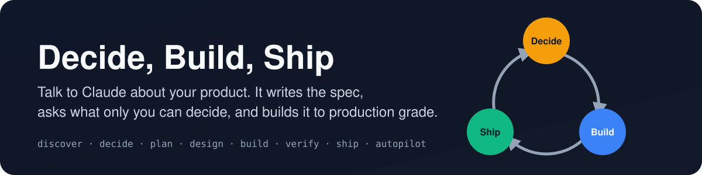
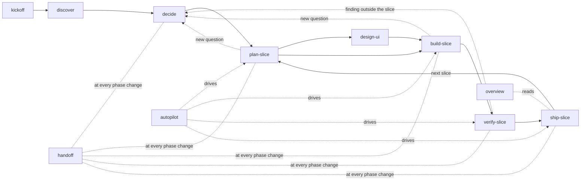

<p align="center">
  
</p>

<p align="center">
  <a href="https://github.com/RohitBind123/decide-build-ship/actions/workflows/check.yml"></a>
  <a href=".claude-plugin/plugin.json"></a>
  <a href="LICENSE"></a>
  <a href="https://code.claude.com/docs/en/plugins"></a>
  
  
  <a href="https://github.com/RohitBind123/decide-build-ship/stargazers"></a>
  <a href="https://github.com/RohitBind123/decide-build-ship/commits/main"></a>
  
</p>

# Decide, Build, Ship

**A complete product team in one Claude Code plugin.** Describe what you want to build. Claude researches the
domain, interviews you like an experienced product lead, writes the spec, designs the interface, builds it test
first with parallel agents, proves it works in the real app, and ships it when you approve. You answer the
questions only you can answer, and ask "where are we?" whenever you like.

It works for web, mobile and desktop apps, backends and APIs, AI and agent products, and startup MVPs. It
assumes no stack, language, hosting or country.

## Quickstart

```text
/plugin marketplace add RohitBind123/decide-build-ship
/plugin install decide-build-ship@decide-build-ship
```

Then, in your project:

```text
Set this repo up for the workflow.
I have an idea for an app that helps dog walkers manage clients, walks and payments. Help me spec it.
Keep going and build milestone 1. I'll check in now and then.
Where are we? Is there anything you need from me?
```

No skill names needed: Claude picks the right one from what you say.

## Why

Coding agents are fast at writing code and bad at knowing what to build. Left alone they guess product
decisions, skip edge cases, and call work done when the tests pass but the screen is broken. Most workflows
start at the code. This one starts at the decisions:

- **Expertise up front.** Claude researches how others solve the problem, suggests the features users will
  expect, and turns your idea into a spec a team could build from.
- **You decide; Claude reviews.** Every open question is explained with a short story and a recommendation.
  Every answer is checked from the users', business, security, cost and AI-risk points of view, and risky
  picks are raised before anything is built on them.
- **Proof, not claims.** Each slice passes a changed-only gate, parallel reviews and a live check of the real
  app, with evidence saved in the repository.
- **Autonomy with guard rails.** Claude can run a whole milestone alone, but releases, money, new dependencies
  and deleting data always come back to you.
- **Nothing lost.** Decisions, plans, evidence and a handoff file live in the repository, so work survives a
  context limit, a crash or a restart.

## What's included

### Skills

| Skill | What it does | Starts when you... |
|---|---|---|
| `kickoff` | Detects the stack, proposes commands, branches, paths and approvals, and writes a `Build workflow` section in `CLAUDE.md` after you confirm | set up a repository |
| `discover` | Researches the domain with sources, interviews you with recommended answers, suggests features, writes the product brief, architecture and a roadmap of milestones | have an idea, need a PRD or spec |
| `decide` | Explains each open question, asks, reviews every answer from several perspectives, records it in the decisions log | start a feature or answer a question |
| `plan-slice` | Splits work into thin vertical slices and plans the next one: decisions, edge cases, tests, screens, files, evidence | ask for a plan or the next slice |
| `design-ui` | Writes the design system, designs every screen state, applies accessibility and platform conventions, reviews screenshots | have screens to design or say "it looks generic" |
| `build-slice` | Docs before code, contract first, failing test first, parallel builders in worktrees, one writer per file set | say "build it" |
| `verify-slice` | Changed-only gate, parallel code, security and design reviews, a live check of the real app, AI evals, evidence | ask "is it done?" |
| `ship-slice` | Merges only when green and approved, never force-pushes shared branches, runs releases and the tidy-up | say "merge", "ship" or "release" |
| `autopilot` | Runs plan, build, verify and ship slice after slice for a milestone, in parallel where safe, stopping only for what needs you | say "keep going" or "build the milestone" |
| `overview` | A read-only report of progress, running work, blockers and what needs you, from files and git state | ask "where are we?" |
| `handoff` | Keeps a paste-ready handoff file in the repository and resumes from it | near a limit, before a restart, at each phase change |

### Agents

| Agent | Role | Model |
|---|---|---|
| `product-researcher` | Read-only domain and competitor research with cited sources | Sonnet |
| `slice-builder` | Builds one file set test first in its own git worktree; never pushes or merges | Sonnet |
| `code-reviewer` | Correctness, tests, errors, performance, maintainability | Sonnet |
| `security-reviewer` | Access, input, secrets, data exposure, AI-specific risks | Opus |
| `design-reviewer` | Reviews real screenshots against the design system and checklist | Sonnet |

### Hook

A `SessionStart` hook tells every new, resumed or compacted session whether a handoff file exists and what its
next step is, so work continues where it stopped. It reads only `CLAUDE.md` and the handoff file.

### Templates

Product brief, architecture, roadmap, design system, one-page spec, decisions log, feature doc, ADR, gate
evidence, overview report, handoff file, and the `Build workflow` section for `CLAUDE.md`.

## How the loop works



Each skill ends by naming the next one. Any skill that meets an open question sends it back to `decide`, so
nothing is decided silently in code. `autopilot` drives the loop; `overview` reports on it.

## A walkthrough

Loafly is a fictional pre-order app for one bakery. Riley owns the bakery and decides what the app does.

1. **Set up.** Riley says "Set this repo up for the workflow." `kickoff` reads the repository, proposes the
   commands, branches, paths and approvals, asks Riley to confirm, then writes the `Build workflow` section.
2. **Discover.** Riley says "Customers should pre-order bread for next-day pickup." `discover` has the
   researcher look at three bakery and click-and-collect products, then interviews Riley in short rounds:
   > Should customers get a reminder before pickup? Sam orders sourdough on Friday night for Saturday 9:00 and
   > forgets; the loaf goes stale. Two of the three closest products send reminders.
   > A (Recommended): email reminder 2 hours before pickup. B: SMS, costs per message. C: none for now.

   It writes the product brief, a short architecture page and a roadmap: M1 ordering and pickup slots, M2 the
   staff order board, M3 an AI ingredient assistant.
3. **Decide.** Open points go through `decide`. When Riley suggests "let the assistant answer allergen
   questions from general knowledge", it pushes back: a confident wrong answer about nuts could harm a customer.
   It recommends answering only from the bakery's ingredient sheets. Riley agrees; the answer is logged in
   Riley's words ([example log](docs/example-decisions-log.md)).
4. **Autopilot.** Riley says "Build M1 and merge what passes." `autopilot` asks for a merge approval covering
   M1 and records it. It then plans each slice, has `design-ui` write the design system before the first
   screen, runs builders in worktrees, verifies each slice with the gate, reviews and a live check, and merges.
5. **Check in.** Two days later Riley asks "Where are we?" `overview` answers: "M1: 3 of 4 slices merged. One
   question waits for you: the slot limit for Saturdays." Riley answers, and the loop continues.
6. **Release.** At the end of M1, `autopilot` shows the demo steps and asks whether to release. Releases always
   ask.

## Install

### As a plugin (recommended)

```text
/plugin marketplace add RohitBind123/decide-build-ship
/plugin install decide-build-ship@decide-build-ship
```

Or from a shell:

```bash
claude plugin marketplace add RohitBind123/decide-build-ship
claude plugin install decide-build-ship@decide-build-ship
```

Plugin skills are namespaced: `/decide-build-ship:discover`, `/decide-build-ship:autopilot` and so on. The
plugin also installs the agents and the SessionStart hook.

### As plain skill folders

```bash
git clone https://github.com/RohitBind123/decide-build-ship.git
cp -R decide-build-ship/skills/* your-project/.claude/skills/     # this project only
cp -R decide-build-ship/skills/* ~/.claude/skills/                # all your projects
cp decide-build-ship/agents/*.md your-project/.claude/agents/     # optional: the agents
```

Copy all the skills together: `kickoff` and `discover` read templates from their sibling skills. The hook is
available only through the plugin.

### Try it without installing

```bash
git clone https://github.com/RohitBind123/decide-build-ship.git
claude --plugin-dir ./decide-build-ship
```

### Recommended companions

Platform depth comes from companion projects with their own licences: Apple HIG review, the official
`frontend-design` plugin, Modern Web Guidance for current web platform features, Playwright for live checks.
See [docs/companion-skills.md](docs/companion-skills.md).

## Documentation

| Doc | What it covers |
|---|---|
| [Working with Claude efficiently](docs/working-with-claude.md) | What to say, the Claude Code features the skills use, unattended runs, cost |
| [Configuration](docs/configuration.md) | Every key of the `Build workflow` section and its default |
| [Companion skills](docs/companion-skills.md) | Design, testing and security companions and how to install them |
| [Testing](docs/testing.md) | The lint, the plugin validator and the behavioural evals |
| [Research notes](docs/research-notes.md) | The official guidance behind the design, with sources |
| [Example decisions log](docs/example-decisions-log.md) | A filled log for the Loafly example |

## Testing

```bash
python3 scripts/check_skills.py                                   # structural lint, free
claude plugin validate . --strict                                 # official validator, free
claude plugin eval . --allow-tools Write --no-publish             # behavioural evals, uses model calls
```

## Design principles

- **The owner decides; Claude reviews.** Choices are explained before they are asked and checked before they
  are built on.
- **Product-agnostic.** No stack, country or tool is assumed; the project's `CLAUDE.md` fills the gaps.
- **Small skills, detail on demand.** Each `SKILL.md` stays around 110 lines or fewer; detail lives in
  `references/` and templates in `assets/`, loaded only when needed.
- **Portable.** Skill frontmatter uses only `name`, `description` and `license`, so the same folders work as a
  plugin, as copied skills, and in other tools that read the Agent Skills format.
- **Never trade quality for speed**, including in long or unattended runs.

## Contributing

See [CONTRIBUTING.md](CONTRIBUTING.md). Changes are recorded in [CHANGELOG.md](CHANGELOG.md).

## License

MIT. See [LICENSE](LICENSE). Companion projects keep their own licences.
