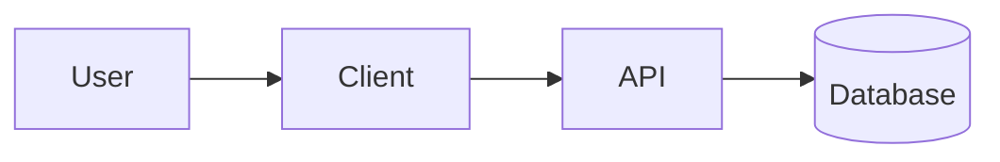

# <Product name>: architecture

- Status: Draft | Approved (<date>, by <owner>)
- Last updated: <date>
- Related: product brief <link>, ADRs <folder>

## Overview

<Two or three sentences: the main parts and how they talk.>

## Stack

| Layer | Choice | Why | Rejected alternative | ADR |
|---|---|---|---|---|
| Client | <choice> | <reason> | <alternative and why not> | <link or none> |
| API | | | | |
| Database | | | | |
| Auth | | | | |
| Hosting | | | | |
| Background jobs | | | | |
| AI provider (if any) | | | | |
| Payments (if any) | | | | |

Owner decisions in this table (cost, vendor lock-in): <list with D-numbers>.

## Components

| Component | Responsibility | Owns data | Talks to |
|---|---|---|---|
| <component> | <one sentence> | <entities> | <components> |

## Data

- Storage per entity and why.
- Migrations: <tool and rules>.
- Backups and restore: <schedule, retention, last tested restore>.

## Interfaces

- Contract files: <for example `api/openapi.yaml`, event schemas, prompt and tool definitions>.
- Versioning and compatibility rules.

## Security

- Sign-in and sessions: <method>.
- Roles and permissions: <model>.
- Secrets: <where they live>.
- Threats to design against: <for example account takeover, data leak between tenants, prompt injection>.

## Quality attributes

How the design meets each non-functional requirement in the brief (performance, availability, reliability,
observability, cost), with the mechanism, not just the target.

## Environments and delivery

- Environments: local (throwaway data), preview, production.
- CI: <checks that run on each change>.
- Release: <steps, rollback>.

## Open questions

- <question>: <D-number>.
